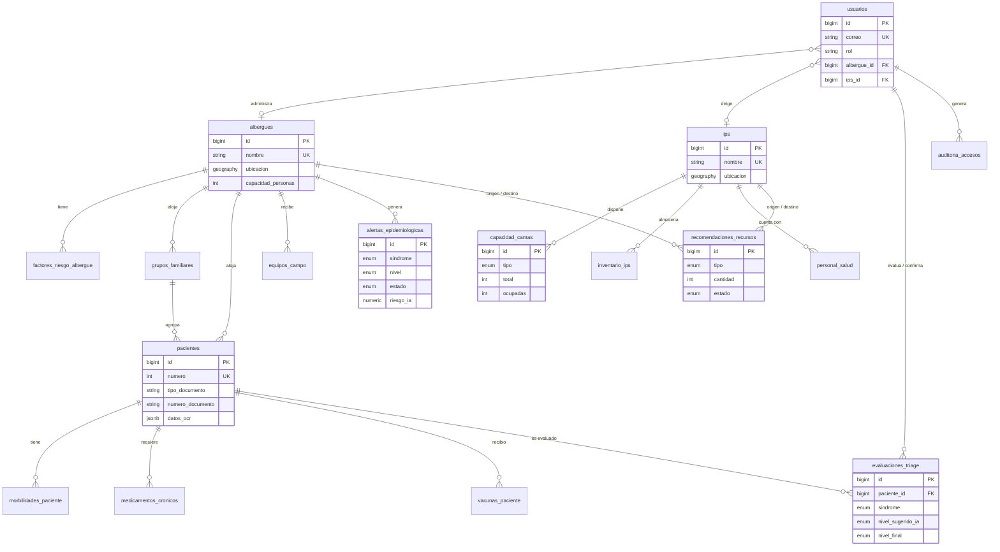

# Modelo Entidad-Relacion (PostgreSQL + PostGIS)

Scripts en `backend/db/init/` (se ejecutan en orden alfabetico al crear la
base de datos en Docker). Textos y nombres en espanol, igual que la app.

| Archivo | Contenido |
|---|---|
| `01-extensiones.sql` | PostGIS |
| `02-tipos.sql` | enumerados (triage, sindromes, alertas...) y trigger de `actualizado_en` |
| `03-usuarios.sql` | usuarios y 5 roles |
| `04-albergues-censo.sql` | albergues, factores de riesgo, familias, pacientes, morbilidades, medicamentos cronicos, vacunas |
| `05-triage.sql` | evaluaciones de triage (signos vitales + sugerencia IA + decision humana) |
| `06-hospitales.sql` | IPS, camas, inventario, personal, equipos de campo |
| `07-vigilancia-recursos.sql` | alertas epidemiologicas, recomendaciones de recursos, auditoria |
| `08-indices-vistas.sql` | indices (GiST espaciales) y vistas analiticas |
| `90-datos-ejemplo.sql` | datos de ejemplo para desarrollo (borrar en produccion) |



## Decisiones de diseno

- **La IA sugiere, la persona decide.** `evaluaciones_triage` guarda
  `nivel_sugerido_ia` y `nivel_final` por separado, con quien lo confirmo
  (exclusion del alcance: sin IA autonoma sin supervision medica).
- **Escala de triage** `verde | amarillo | rojo | negro` (reemplaza P1/P2/P3 de
  la app; el cambio en la app va en `feature/triage-4-niveles`).
- **PostGIS**: `albergues`, `ips` y `grupos_familiares` guardan
  `geography(Point, 4326)` con indice GiST, para mapas y analisis espacial de brotes.
- **Vistas para IA y dashboard**: `v_casos_sindrome_dia` (insumo del detector
  de brotes) y `v_ocupacion_camas` (matriz demanda vs. capacidad).
- **Habeas Data**: `auditoria_accesos` registra quien consulta o exporta datos
  de salud. El cifrado y los permisos por rol se implementan en
  `feature/auth-5-roles`.
- **Roles**: el registro publico crea usuarios `brigadista` (menor privilegio);
  el cambio de rol lo hace un coordinador municipal. El rol heredado `usuario`
  ya no existe.
- **Usuarios de prueba** (solo desarrollo, en `90-datos-ejemplo.sql`): uno por
  rol, correo `<rol>@sigep.test`, contrasena `Sigep2026*`.

## Reiniciar la base de datos

Los scripts solo corren cuando el volumen esta vacio:

```
docker compose down -v
docker compose up --build
```
